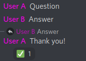
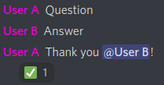
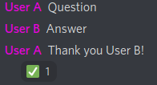
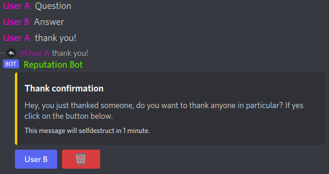
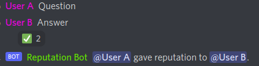

Members give reputation the way they already say thank you. The bot watches for **thank words** like "thanks" or
"thx" and works out who was thanked. There is no need to remember a command.

Every reputation is tied to a message. If that message goes away, the reputation goes with it. See
[removing reputation](./removing-reputation.md).

Your server decides which of the ways below are active. You turn them on and off in the
[dashboard](../getting-started/dashboard.md) under **Settings > Reputation**:

| Way | Toggle in the dashboard |
|---|---|
| [Answer](#answer) | Answer Reputation |
| [Mention](#mention) | Mention Reputation |
| [Fuzzy matching](#fuzzy-matching) | Fuzzy Matching |
| [Embed](#embed) | Embed Reputation |
| [Direct embed](#direct-embed) | Direct Embed Reputation, shown while Embed Reputation is on |
| [Reaction](#reaction) | Reaction Reputation |
| [Command](#command) | Command Reputation |

## Who can give and receive

Before the bot gives reputation, it checks a few things:

- The message is in a reputation channel. See [channels](../configuration/channels.md). Only the `/reputation`
  command works everywhere.
- The way of giving is turned on for your server.
- Nobody thanks themselves. Self thanks never count.
- Bots don't receive reputation. They can only give it if your server has an integration bypass for them.
- The giver and the receiver have the right roles, if your server limits that. See
  [roles](../configuration/roles.md).
- The [abuse protection](../configuration/abuse-protection.md) allows it: cooldowns, limits, message age and the
  conversation checks below.

### Part of the conversation

By default, both the giver and the receiver need to be part of the recent conversation in the channel. This keeps
people from thanking someone who wasn't involved. Take this chat:

```text
User A: Some message
User B: I have a question...
User C: Here is the answer.
User B: Thank you!
```

User B started asking after User A's message, so only members who wrote after that count. User C can receive
reputation from User B. User A can't. Your server can turn these checks off on the
[abuse protection](../configuration/abuse-protection.md) page.

### Voice activity

Members who share a voice channel with you, or did so a short while ago, also count as part of your conversation.
This way you can thank someone who helped you in a voice call, in any reputation channel.

## Answer

Reply to a member's message and say thanks. The author of the message you replied to receives the reputation.



A reply always counts as an answer. If **Answer Reputation** is off, a thank you in a reply gives no reputation at
all, even when it mentions someone.

## Mention

Mention the member in your thank you. Every member you mention receives reputation.



If you mention more members than one message may reward (**Max Message Reputation** in the abuse protection, 3 by
default), the bot ignores the mentions and tries fuzzy matching instead.

## Fuzzy matching

Write the member's name without a mention. The bot compares up to six words before and after each thank word with the
names of the members in the conversation and picks names that match closely.



The bot only gives reputation when it is quite sure. If no name matches well enough, it falls back to the embed.

## Embed

When the bot finds a thank word but can't tell who you mean, it asks you. It answers with an embed that has a button
for each member of the recent conversation, up to 10 of them.



- Only the member who said thanks can click the buttons.
- You can pick as many members as one message may reward (**Max Message Reputation**).
- Members who can't receive reputation from you right now, for example because of a cooldown, are left out.
- The embed deletes itself after one minute. You can also delete it with its delete button.

## Direct embed

If only one member could be in the embed, the bot can skip it and give the reputation to that member right away.
Turn on **Direct Embed Reputation** for this.

## Reaction

React to a member's message with your server's reputation emoji. The author of the message receives the reputation.
Your server sets a main reaction and, as a supporter feature, additional ones. See
[thank words and reactions](../configuration/thankwords-and-reactions.md).



If the message you react to already gave someone reputation, for example a thank you, your reaction goes to that
member instead. You agree with the thanks and add your own.

## Command

With **Command Reputation** on, members can use `/reputation <user>` to give reputation. It is off by default, and
the command only shows up on servers that turned it on.

- The command works in every channel, not only in reputation channels.
- All other checks still apply, including the conversation checks. The **Simple Reputation System**
  [preset](../getting-started/first-setup.md#presets) turns those off for you.
- With **Ephemeral Response** on (shown below Command Reputation), only the giver sees the bot's answer. See
  [reputation given by command](../configuration/announcements.md#reputation-given-by-command).
- Supporters can give the command another name. See
  [custom command names](./profiles-and-rankings.md#custom-command-names).
