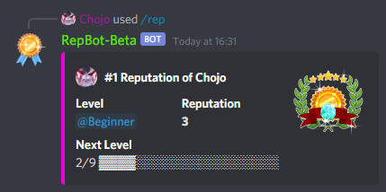

Every member has a reputation profile, and every server has rankings. Both count reputation in your server's
[reputation mode](./reputation-modes.md).

## Profiles

Use `/profile` to see your own profile, or `/profile <user>` for someone else's.

The profile shows:

- the member's rank on the server,
- their **Level**, which is their current [rank role](../configuration/roles.md),
- the reputation they received and the reputation they gave,
- how far they are from the next level.

The bot can show a badge on the profiles of the highest ranked members. Which ranks get a badge depends on how the
bot is set up.

Supporters can set the `detailed` option of `/profile` to true to get a detailed profile. It adds the rank for given
reputation, the members someone received the most from and gave the most to, and the channels where they gave and
received the most.

You can also open profiles in the [dashboard](../getting-started/dashboard.md) under **Dashboard > Profile**. Use
**Share** there to copy a link to your profile. In your **User Settings**, turn on **Public Profile** to let people
open that link even when they don't share a server with you.

## Rankings

Use `/top` to see the ranking of your server. It lists the members with the most received reputation, 10 per page.

To see another time frame than your server's reputation mode, pick a mode: `/top mode:7 days`. The modes are
`total`, `7 days`, `30 days`, `week` and `month`. See [reputation modes](./reputation-modes.md).

`/ranking` offers more rankings. The `mode` option works the same as for `/top`.

| Command | What it shows |
|---|---|
| `/ranking server received` | The members with the most received reputation. The same as `/top`. |
| `/ranking server given` | The members who gave the most reputation. |
| `/ranking user received [user]` | The members someone received the most reputation from. |
| `/ranking user given [user]` | The members someone gave the most reputation to. |

Everything except `/ranking server received` is a supporter feature (**Advanced Rankings**). The same rankings are in
the dashboard under **Dashboard > Ranking**.

Members whose data is about to be removed because they left your server don't show up in rankings, and their
profile shows no reputation. See
[removing reputation](./removing-reputation.md#members-who-leave).

## Custom command names

Supporters can give `/reputation` and `/profile` their own name on their server, for example `/karma`. Set them in
the dashboard under **Settings > Command Names**.

- A new name for `/reputation` replaces it. The name only shows up while
  [command reputation](./giving-reputation.md#command) is on.
- A new name for `/profile` is added next to it. `/profile` keeps working.
- Names are 1 to 32 characters long and use lowercase letters, numbers, `-` and `_`.
- A name can't be the name of another command of the bot, and both commands can't share one name.
- Clear the name, or use **Reset**, to go back to the original name.

If your server loses the supporter feature, the custom names disappear within a minute or two. They come back when the
feature is active again.
